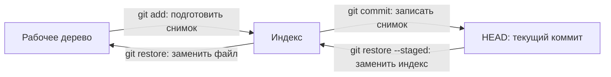

# Git

Откройте справочник, когда нужно подготовить коммит, отменить изменение или обновить ветку.
Выберите ситуацию в таблице.
Ссылка ведёт к короткой карточке с примером и последствиями.
[GitHub Pull Requests](../github-pull-requests/README.md) описаны отдельно.

## Быстрый поиск

| Ситуация | Выбор команды | Карточка и пример |
| --- | --- | --- |
| Посмотреть правки и подготовить коммит | `status` → `diff` → `add` → `diff --staged` | [Проверить и закоммитить](workflow.md#посмотреть-изменения-и-подготовить-коммит) |
| Временно переключиться на другую задачу | `stash push -u` → `apply` | [Отложить работу](workflow.md#временно-отложить-работу) |
| Убрать файл из следующего коммита, сохранив правки | `restore --staged` | [Убрать из индекса](history.md#убрать-файл-из-индекса) |
| Отбросить незакоммиченную правку файла | `restore` с выбранным источником | [Отменить правки](history.md#отменить-незакоммиченные-изменения) |
| Убрать последний локальный коммит, сохранив правки | `reset --soft` или `--mixed` | [Отменить коммит](history.md#отменить-коммит-с-сохранением-изменений) |
| Отменить опубликованное изменение | `revert` | [Добавить обратный коммит](history.md#отменить-опубликованное-изменение) |
| Вернуть потерянный коммит | `reflog` → `show` → `branch rescue` | [Восстановить коммит](history.md#восстановить-потерянный-коммит) |
| Обновить ветку и решить конфликт | `fetch` → выбор merge/rebase | [Выбрать интеграцию](remotes.md#получить-изменения-и-выбрать-интеграцию) |
| Обновить удалённую ветку | Обычный push; явный lease после согласованного rebase | [Выбрать способ push](remotes.md#выбрать-способ-обновления-удалённой-ветки) |
| Удалить ветку после проверки | Проверка main/PR → `branch -d` | [Проверить результат](remotes.md#удалить-ветку-после-проверки-результата) |

| Параметр | Значение |
| --- | --- |
| Ветка API | Git CLI; `switch` и `restore` появились в Git 2.23 |
| Предпосылки | Терминал, установленный Git, понимание текущего каталога |

## Навигация

- [Базовый уровень](#базовый-уровень): состояние файлов и подготовка коммита.
- [Средний уровень](#средний-уровень): stash, отмена и интеграция.
- [Продвинутый уровень](#продвинутый-уровень): восстановление, rebase и lease.
- [Частые ошибки](#частые-ошибки).
- [Источники](#источники).
- Подробные страницы: [рабочий процесс](workflow.md), [отмена и восстановление](history.md), [удалённые ветки](remotes.md).

## Базовый уровень

### Различать HEAD, индекс и рабочее дерево

| Объект | Что хранит | Как посмотреть |
| --- | --- | --- |
| `HEAD` | Текущий коммит; обычно через текущую локальную ветку | `git log -1 --oneline` |
| Индекс | Подготовленный снимок следующего коммита | `git diff --staged` относительно HEAD |
| Рабочее дерево | Файлы на диске, включая ещё не добавленные правки | `git diff` относительно индекса; `git status --short` для новых файлов |

Схема показывает перенос снимков между состояниями.
`restore` заменяет содержимое выбранного назначения и может удалить правки.

В `git status --short` первый столбец показывает индекс относительно HEAD.
Второй столбец показывает рабочее дерево относительно индекса.
`??` обозначает неотслеживаемый файл.
`MM` означает, что после `add` файл изменили ещё раз.
Коммит получит версию из индекса.
[Карточка подготовки коммита](workflow.md#посмотреть-изменения-и-подготовить-коммит) показывает проверки по порядку.

`git init -b main` создаёт репозиторий.
`git clone URL` получает существующий репозиторий.
Замените `URL` адресом проекта.
URL и права доступа зависят от проекта.
[Настройте автора](workflow.md#настроить-автора-и-интерфейс) перед первым коммитом.

## Средний уровень

### Выбирать по состоянию работы

| Нужно сохранить | Ситуация | Переход |
| --- | --- | --- |
| Незакоммиченные файлы | Временно сменить задачу | [Stash с проверкой перед drop](workflow.md#временно-отложить-работу) |
| Текст файла | Убрать файл только из индекса | [Restore staged](history.md#убрать-файл-из-индекса) |
| Изменения последнего коммита | Коммит ещё не опубликован | [Soft или mixed reset](history.md#отменить-коммит-с-сохранением-изменений) |
| Общую историю | Изменение уже опубликовано | [Revert](history.md#отменить-опубликованное-изменение) |
| Существующие коммиты ветки | Получить изменения основной ветки | [Merge и разрешение конфликта](remotes.md#обновить-ветку-и-разрешить-конфликт) |

## Продвинутый уровень

### Различать локальную и удалённую ветки

| Имя | Где находится | Когда обновляется |
| --- | --- | --- |
| `feature/profile` | Локальная ветка | При локальном коммите, merge, rebase или reset |
| `origin/feature/profile` | Локальная ссылка на известное состояние remote | Обычно при fetch; может отставать от сервера |
| `refs/heads/feature/profile` на `origin` | Ветка в удалённом репозитории | При принятом сервером push или другом серверном изменении |

`fetch` получает объекты и обновляет ссылки согласно настройкам remote.
Обычный fetch не интегрирует изменения в текущую ветку.
`pull` сочетает получение и интеграцию.
`push` изменяет удалённые ссылки.

- [Исправьте свой последний коммит](history.md#исправить-свой-последний-коммит), если коммит ещё не опубликован.
- [Перебазируйте свою ветку](history.md#перебазировать-свою-ветку), если правила проекта допускают новые идентификаторы коммитов.
- [Создайте rescue-ветку](history.md#восстановить-потерянный-коммит), прежде чем двигать текущую ветку ради восстановления.
- [Проверьте явный lease](remotes.md#переписать-свою-ветку-с-проверкой) перед согласованным переписыванием удалённой ветки.

Полные сценарии: [коммит и stash](workflow.md#проверяемый-рабочий-процесс),
[restore/reset/revert/reflog](history.md#проверить-режимы-reset-и-revert),
[конфликты merge/rebase](history.md#проверить-конфликты-merge-и-rebase),
[lease и удаление веток](remotes.md#проверить-rebase-lease-и-удаление-веток).
Все сценарии используют отдельные временные репозитории.

## Частые ошибки

| Симптом | Причина | Действие |
| --- | --- | --- |
| Push rejected | Новые коммиты на сервере или защита ветки | Выполните fetch. Изучите расхождение и правила проекта |
| После `--hard` пропал текст | Заменены индекс и отслеживаемые файлы | Ищите сохранённый коммит или внешнюю копию. Reflog не хранит каждый незакоммиченный текст |
| `.gitignore` не скрывает файл | Файл уже отслеживается | [Прекратите отслеживание](history.md#убрать-файл-из-индекса), если это задача команды |
| `branch -d` отказался после squash | Исходные коммиты не стали предками main | [Проверьте PR и содержимое](remotes.md#удалить-ветку-после-проверки-результата) |
| Видны неожиданные изменения | Открыта другая ветка или папка | Проверьте `pwd`, `git branch --show-current`, `git status` |

## Источники

- [Руководства Git v2.55.0](https://github.com/git/git/tree/v2.55.0/Documentation), [release notes 2.55.0](https://raw.githubusercontent.com/git/git/v2.55.0/Documentation/RelNotes/2.55.0.adoc).
- [Status](https://git-scm.com/docs/git-status/2.55.0), [restore](https://git-scm.com/docs/git-restore/2.55.0), [push](https://git-scm.com/docs/git-push/2.55.0).
- [Conventional Commits 1.0.0](https://www.conventionalcommits.org/en/v1.0.0/).

[Инструменты разработки](../README.md) · [Указатель задач](../../tasks/README.md#git-и-github)
