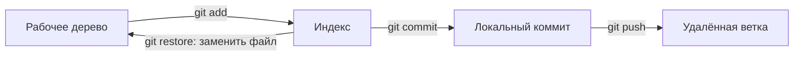

# Git

Версионирование файлов: рабочее дерево → индекс → коммит → удалённая ветка.
Git не включает GitHub Pull Requests.
Для Pull Requests есть [отдельный справочник](../github-pull-requests/README.md).

| Параметр | Значение |
| --- | --- |
| Ветка API | Git CLI; `switch` и `restore` требуют Git 2.23+ |
| Предпосылки | Терминал, установленный Git, понимание текущего каталога |
| Сверено с документацией | 2026-11-06, официальные руководства Git и Conventional Commits 1.0.0 |
| Выполнено | 2026-11-06, Git 2.55.0 на macOS; учебные ветки, локальный bare remote, reset/revert/rebase и отклонение устаревшего lease |

## Навигация

- [Быстрый поиск](#быстрый-поиск)
- [Базовый уровень](#базовый-уровень)
- [Средний уровень](#средний-уровень)
- [Продвинутый уровень](#продвинутый-уровень)
- [Частые ошибки](#частые-ошибки)
- [Источники](#источники)
- [Рабочий процесс и настройки](workflow.md)
- [Отмена, восстановление и rebase](history.md)
- [Удалённые ветки и force-with-lease](remotes.md)

## Быстрый поиск

Команды в таблице — отдельные операции в уже открытом репозитории.
Имена файлов и веток приведены как примеры.

| Задача | Команда | Подробнее |
| --- | --- | --- |
| Проверить изменения | `git status --short`, `git diff`, `git diff --staged` | [Рабочий процесс](workflow.md) |
| Выбрать файл для коммита | `git add -- app.py` | [Рабочий процесс](workflow.md) |
| Создать ветку | `git switch -c feature/profile` | [Учебный пример](workflow.md#проверяемый-рабочий-процесс) |
| Посмотреть историю | `git log --oneline --graph --all` | [Рабочий процесс](workflow.md) |
| Убрать файл из индекса | `git restore --staged -- app.py` | [Отмена](history.md) |
| Отменить опубликованное изменение | `git revert COMMIT` — новый обратный коммит | [Отмена](history.md) |
| Получить remote-ссылки | `git fetch origin` | [Удалённые ветки](remotes.md) |
| Обновиться только fast-forward | `git pull --ff-only` | [Удалённые ветки](remotes.md) |
| Найти прежний HEAD | `git reflog` → `git branch rescue COMMIT` | [Восстановление](history.md) |

## Базовый уровень

### Начать работу

`git init -b main` создаёт репозиторий.
`git clone URL` получает существующий репозиторий.
URL, права доступа и имя основной ветки зависят от проекта.
Настройте имя и email автора локально либо глобально.
Выбирайте область настройки осознанно.
Имя и email — метаданные коммита, а не данные входа на сервер.

Перед коммитом выполните последовательность: `status` → `diff` → выборочные `add` → `diff --staged` → `commit`.
`git add .` добавляет изменения внутри текущего каталога и может захватить лишние файлы.
`.gitignore` влияет на неотслеживаемые файлы, но не прекращает отслеживание уже добавленных.

Полный воспроизводимый пример без сетевого доступа — [рабочий процесс](workflow.md).

## Средний уровень

### Сочетать ветки и временные изменения

`git switch main` переключает ветку.
`git merge feature/profile` интегрирует `feature/profile` в текущую ветку.
При конфликте изучите `git status`.
Отредактируйте конфликтующий файл.
Добавьте разрешение конфликта в индекс.
Продолжите merge.
Для отмены незавершённого merge используйте `git merge --abort`.

`git stash push -u -m 'work in progress'` сохраняет также неотслеживаемые файлы, но не игнорируемые.
`git stash apply` восстанавливает изменения.
Команда сохраняет запись stash.
После проверки `git stash drop` удаляет запись.
При успехе `pop` совмещает применение и удаление.
Возможны конфликты.

Сообщение коммита описывает одну логическую задачу.
[Conventional Commits](workflow.md#сообщения-коммитов) — соглашение команды.
Git не требует это соглашение.

## Продвинутый уровень

### Выбрать способ изменения истории

| Требование | Подход | Последствие |
| --- | --- | --- |
| Сохранить общую опубликованную историю | `revert` | Добавляет обратный коммит |
| Исправить последний свой неопубликованный коммит | `commit --amend` | Создаёт новый коммит с другим идентификатором |
| Перенести свою ветку на новую базу | `rebase` | Пересоздаёт переприменённые коммиты. Возможны конфликты |
| Передвинуть локальную ветку | `reset` | Изменение индекса/файлов зависит от режима |

Сначала выполняйте рецепты с изменением истории в [учебном репозитории](history.md).
Переписывайте опубликованную совместную ветку только по согласованному процессу.
[Lease с ожидаемым SHA](remotes.md#переписать-свою-ветку-с-проверкой) проверяет состояние remote.
Lease не заменяет проверку содержимого и согласование.

## Частые ошибки

| Симптом | Причина | Действие |
| --- | --- | --- |
| Push rejected | На сервере есть новые коммиты или действует защита ветки | Выполните `fetch`. Изучите расхождение. Затем выполните merge/rebase по правилам проекта |
| После `--hard` пропала локальная правка | Сброшены индекс и отслеживаемые файлы | Git может не хранить незакоммиченный текст. Reflog не является резервной копией файлов |
| Файл остаётся в Git после `.gitignore` | Он уже отслеживается | Выполните `git rm --cached -- file`. Создайте коммит. Файл останется локально |
| `branch -d` отказался после squash | Исходные коммиты не являются предками проверяемой ссылки | При заданном upstream проверяется upstream, иначе HEAD. Успешное удаление не доказывает merge в main. Проверьте PR и diff |
| Видны не те изменения | Открыта другая ветка/каталог | Проверьте `pwd`, `git branch --show-current`, `git status` |

## Источники

- [Git: базовые операции](https://git-scm.com/docs/gittutorial), [switch](https://git-scm.com/docs/git-switch), [restore](https://git-scm.com/docs/git-restore).
- [reset](https://git-scm.com/docs/git-reset), [revert](https://git-scm.com/docs/git-revert), [rebase](https://git-scm.com/docs/git-rebase).
- [push и force-with-lease](https://git-scm.com/docs/git-push), [stash](https://git-scm.com/docs/git-stash).
- [Conventional Commits 1.0.0](https://www.conventionalcommits.org/en/v1.0.0/).

[Инструменты разработки](../README.md)
