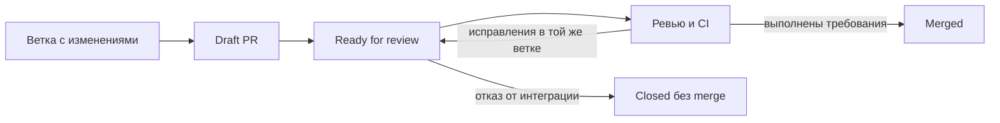

# GitHub Pull Requests

Pull Request — предложение интегрировать изменения исходной ветки (head/compare) в целевую (base).
Это возможность GitHub поверх [Git](../git/README.md): обсуждение, ревью, проверки и решение о слиянии.

| Параметр | Значение |
| --- | --- |
| Сервис | GitHub.com; права, rulesets и доступные merge methods зависят от репозитория |
| Предпосылки | Ветки и push в Git; для примеров CLI — установленный и авторизованный `gh` |
| Сверено с документацией | 2026-11-06, GitHub Docs и руководство GitHub CLI |
| Выполнено | Внешние действия GitHub и `gh` не выполнялись; локальные Git-сценарии проверены в теме Git |

## Навигация

- [Быстрый поиск](#быстрый-поиск)
- [Базовый уровень](#базовый-уровень)
- [Средний уровень](#средний-уровень)
- [Продвинутый уровень](#продвинутый-уровень)
- [Частые ошибки](#частые-ошибки)
- [Источники](#источники)
- [Описание, ревью и проверки](review.md)
- [Синхронизация, слияние и очистка веток](merging.md)

## Быстрый поиск

Команды ниже — справочные фрагменты.
Эти команды не выполнялись.
`create`, `ready`, `merge` меняют состояние GitHub.

| Задача | Команда / действие | Подробнее |
| --- | --- | --- |
| Создать Draft PR | `gh pr create --draft --base main` | [Описание и ревью](review.md) |
| Посмотреть PR | `gh pr view 123` | [Ревью](review.md) |
| Список PR | `gh pr list` | [Ревью](review.md) |
| Получить ветку локально | `gh pr checkout 123` — меняет рабочую копию | [Синхронизация](merging.md) |
| Проверить CI | `gh pr checks 123` | [Проверки](review.md#перед-слиянием) |
| Сделать PR готовым к ревью | `gh pr ready 123` | [Жизненный цикл](#базовый-уровень) |
| Выбрать merge method | Merge / Squash / Rebase | [Слияние](merging.md) |

## Базовый уровень

### Открыть предложение изменений

1. Сохраните работу в отдельной ветке.
2. Проверьте diff.
3. Выполните тесты.
4. Отправьте ветку в свой remote.
5. На GitHub выберите **New pull request**.
6. Выберите base и compare.
7. Для fork проверьте также репозитории.
8. Опишите задачу.
9. Опишите наблюдаемое изменение.
10. Укажите способ проверки.
11. Укажите существенные ограничения.
12. Для незавершённой работы выберите Draft.
13. Для готовой работы выберите готовность к ревью.
14. Назначьте подходящих ревьюеров.

Новые коммиты и force push в ту же head-ветку отражаются в PR автоматически.
Редактирование описания не «перезагружает» историю.
После force push полезно пояснить причину.
Также полезно повторно проверить diff/CI.
Разрешения и защиты могут запретить такой push.

| Состояние | Значение |
| --- | --- |
| Open + Draft | Открыт, но ещё не готов к ревью. Слияние недоступно |
| Open + Ready for review | Открыт и готов к рассмотрению |
| Closed без merge | Закрыт без интеграции этим PR |
| Merged | Изменения интегрированы. PR закрыт |

`Approved` — результат ревью.
Этот результат не является самостоятельным состоянием PR.
Этот результат не гарантирует готовность к merge.

## Средний уровень

### Довести PR до принятого решения

[Страница ревью](review.md) содержит шаблон описания, проверки автора и ревьюера.
Правила проекта определяют число approvals, обязательные CI checks, разрешение обсуждений и требования к base.
Наличие PR само по себе не защищает main.
Нужны соответствующие настройки и соблюдение процесса.

Labels (`bug`, `enhancement`, `documentation` и другие) — соглашение конкретного репозитория.
`Closes #123` связывает PR с задачей.
Автоматическое закрытие зависит в том числе от целевой default branch.

## Продвинутый уровень

### Согласовать историю и стратегию веток

Короткие feature-ветки удобны для независимых изменений.
GitFlow добавляет `develop`, release/hotfix.
GitFlow имеет смысл при подходящем процессе релизов.
Размер проекта сам по себе не требует GitFlow.
Длинные интеграционные ветки требуют регулярной проверки совместимости и понятного владельца.
Частота синхронизации определяется изменениями, а не обязательным утренним/вечерним расписанием.

[Сравнение merge methods](merging.md#выбрать-способ-слияния), согласованный rebase и удаление веток помогают сохранить историю понятной.
Если используется merge queue, очередь управляет интеграцией по правилам репозитория.

## Частые ошибки

| Симптом | Проверить |
| --- | --- |
| В PR лишние коммиты | Проверьте base/head, fork, merge-base и историю ветки. Одно редактирование описания не исправит список коммитов |
| Approved, но merge недоступен | Проверьте CI, protections/rulesets, конфликты, Draft и необходимые права |
| После push CI не изменился | Проверьте настройки событий, фильтры путей/веток и ограничения workflow. PR diff обновляется отдельно |
| После squash локальная ветка «не слита» | Git проверяет предков, а не эквивалентность squash-коммита |
| Ссылка оглавления не работает | Используйте реальные якоря заголовков GitHub. `{#id}` не назначает ID |

## Источники

- [Quickstart PR](https://docs.github.com/en/pull-requests/get-started/pull-request-quickstart).
- [Merge methods](https://docs.github.com/en/repositories/configuring-branches-and-merges-in-your-repository/configuring-pull-request-merges/about-merge-methods-on-github).
- [GitHub CLI create](https://cli.github.com/manual/gh_pr_create), [merge](https://cli.github.com/manual/gh_pr_merge).
- [Markdown и якоря](https://docs.github.com/en/get-started/writing-on-github/getting-started-with-writing-and-formatting-on-github/basic-writing-and-formatting-syntax).

[Инструменты разработки](../README.md)
